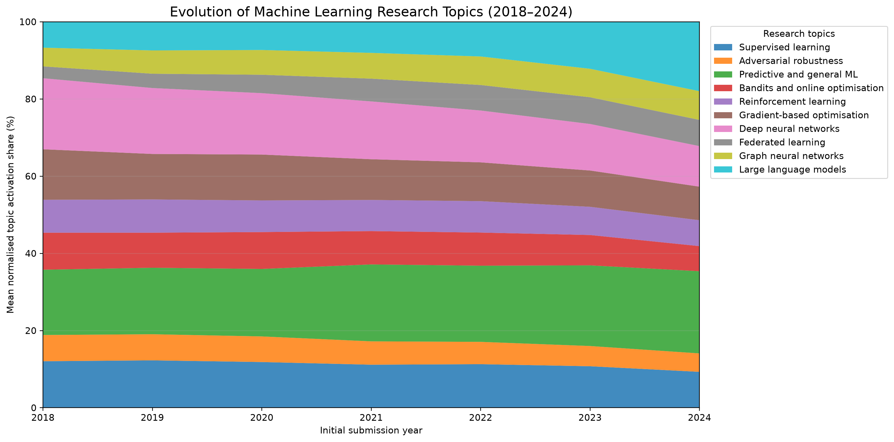
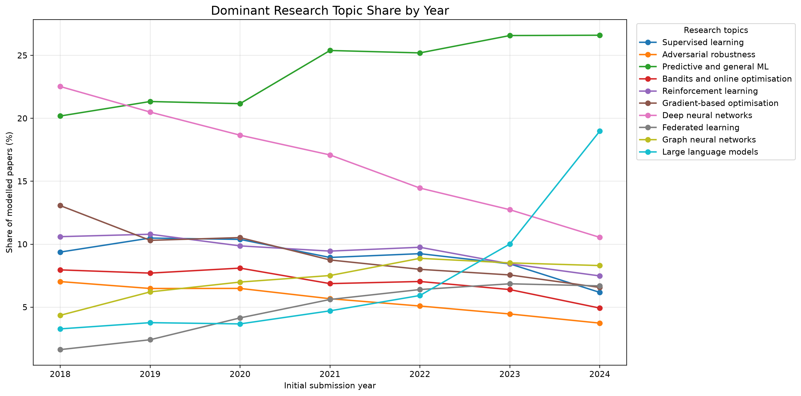
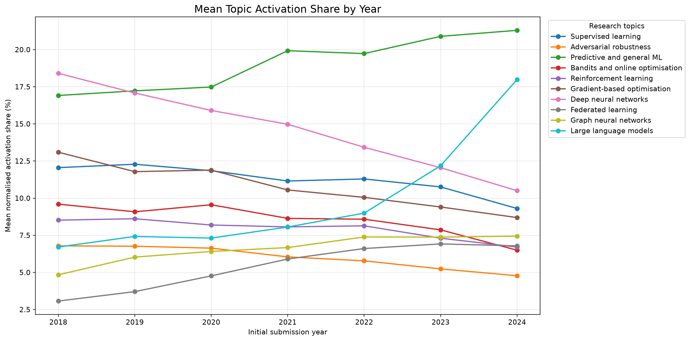

# Topic Detection and Trend Analysis in arXiv Machine-Learning Abstracts (2018–2024)

This project looks at how research themes in arXiv's **Computing Research / Machine Learning (`cs.LG`)** category changed between 2018 and 2024. It uses paper metadata and abstracts, cleans the text, builds sparse term representations, compares NMF and LDA topic models, and then follows ten topics across the seven submission years.

The work is deliberately descriptive. It does not try to predict what researchers will study next, and it does not claim that the ten discovered topics are a definitive taxonomy of machine learning. The labels are working interpretations of the final model's top terms and still need independent human confirmation.

## Project at a glance

| Item | Result |
|---|---:|
| Filtered arXiv `cs.LG` records, 2018–2024 | 87,945 |
| Documents with usable TF–IDF features in the final model | 87,944 |
| Records retained but not modelled because their cleaned token list was empty | 1 |
| Final topic model | NMF, 10 topics |
| Years analysed | 2018–2024 |
| Trend charts | 3 |
| Last recorded full test run | 46 passed (Phase 10B) |

The single unmodelled record remains in the metadata and annual corpus counts. It is not silently discarded from the project dataset.

## Why this project was built

The central question is straightforward: **what themes can be found in machine-learning abstracts on arXiv, and how did their relative share change from 2018 to 2024?**

There are two useful ways to look at a topic model over time. One assigns each paper to the topic with its largest activation. The other keeps the full mixture of topics in each paper and averages those normalised activations within each year. This project reports both, because a single dominant label can hide the fact that a paper touches several themes.

## Main findings

A few patterns stand out in the final model:

- **Large language models** show the strongest increase. Their mean normalised activation share rises from **6.71% in 2018 to 17.99% in 2024**, a gain of 11.28 percentage points. Their dominant-topic share rises from 3.27% to 18.98%.
- **Predictive and general machine learning** is the largest topic by mean activation share in every year from 2019 to 2024. Its mean share moves from 16.91% in 2018 to 21.30% in 2024.
- **Deep neural networks** become a smaller part of the modelled topic mixture: mean activation share moves from 18.41% to 10.50% over the same period.
- **Federated learning** and **graph neural networks** both gain share, although their 2024 levels remain below the two largest topics.

These are changes in *relative share within the selected `cs.LG` corpus*. They should not be read as changes in the absolute number of papers, nor as proof that one research area caused another to grow or shrink. The total number of papers in the filtered corpus also increased, from 4,736 in 2018 to 20,076 in 2024.

## Trend figures

### Relative topic composition



### Dominant-topic share



### Mean topic activation share



## The ten final-model topics

The numbering below follows the **final full-corpus NMF model** used for the trend charts. Topic labels are provisional and should be checked against representative papers before they are treated as final.

| Topic | Working label | Terms that help identify it |
|---:|---|---|
| 1 | Supervised learning | data, distribution, label, sample, class, supervised, classification |
| 2 | Adversarial robustness | adversarial, attack, robustness, perturbation, defense, robust |
| 3 | Predictive and general ML | prediction, machine, time, system, series, application |
| 4 | Bandits and online optimisation | regret, algorithm, bandit, optimal, lower bound, online |
| 5 | Reinforcement learning | policy, agent, reinforcement, environment, reward, action |
| 6 | Gradient-based optimisation | gradient, optimisation, convergence, descent, stochastic, convex |
| 7 | Deep neural networks | network, neural, deep, layer, architecture, convolutional |
| 8 | Federated learning | federated, client, privacy, communication, distributed, server |
| 9 | Graph neural networks | graph, node, GNN, representation, edge, embedding |
| 10 | Large language models | language, model, LLM, transformer, fine-tuning, code |

## Method in brief

1. Start with the Cornell University arXiv metadata snapshot distributed through Kaggle. The project records snapshot version **311** and the source-file SHA-256 checksum in its ingestion record.
2. Keep records whose primary category is exactly `cs.LG` and whose first-submission year is 2018–2024, inclusive.
3. Explore the filtered metadata and clean abstracts using lowercase tokenisation, NLTK English stopwords, and WordNet noun lemmatisation.
4. Build sparse TF–IDF and count representations with up to 8,000 features.
5. Compare NMF and LDA on a deterministic 8,000-document sample, using a 6,400/1,600 training/validation split. The validation vectorisers are fitted on training documents only.
6. Compare topic counts 5, 8, 10, and 12. For NMF, evaluate five random seeds and lexical stability of the top terms.
7. Fit the selected NMF K=10 configuration on all documents with usable features and calculate yearly topic shares from that one common model.

The complete decisions and caveats are recorded in [`docs/METHODOLOGY.md`](docs/METHODOLOGY.md) and [`docs/LIMITATIONS.md`](docs/LIMITATIONS.md).

## Repository layout

```text
.
├── README.md
├── pyproject.toml
├── requirements.txt
├── .gitignore
├── docs/
│   ├── FINAL_PROJECT_REPORT.md
│   ├── METHODOLOGY.md
│   ├── LIMITATIONS.md
│   ├── REPRODUCIBILITY.md
│   ├── DATA_AND_ETHICS.md
│   ├── TOPIC_REVIEW_PROTOCOL.md
│   ├── PHASE11_QA_CHECKLIST.md
│   ├── architecture.md
│   ├── data_dictionary.md
│   ├── methodology-decisions.md
│   └── templates/
│       └── final_model_topic_label_review_template.csv
├── data/
│   ├── raw/                    # Local source snapshot; not committed
│   ├── processed/              # Local filtered and preprocessed data
│   └── features/               # Local sparse matrices and vectorisers
├── src/arxiv_topic_trends/
│   ├── data/
│   ├── preprocessing/
│   ├── features/
│   └── models/
├── tests/
└── outputs/
    └── reports/
        ├── topic_trends_2018_2024/
        └── topic_review_k10/
```

The exact source files and saved model artefacts remain in the working project. Large raw data, feature matrices, and fitted model files are intentionally excluded from this documentation package and should stay out of GitHub.

## Set up the environment

The project was run on Windows 11 with Python 3.13.7. From the repository root, create and activate a virtual environment:

```powershell
py -3.13 -m venv .venv
.\.venv\Scripts\Activate.ps1
python -m pip install --upgrade pip
python -m pip install -e ".[analysis,test]"
```

The analysis uses NumPy, pandas, scikit-learn, NLTK, Gensim, SciPy, and Matplotlib. NLTK's English stopwords and WordNet resources must also be available; the preprocessing stage checks for the required resources. See [`docs/REPRODUCIBILITY.md`](docs/REPRODUCIBILITY.md) for the recorded environment and commands.

## Run checks and the final reporting stages

Run the test suite from the project root:

```powershell
python -m pytest -q
```

The last recorded full test run before chart generation reported **46 passed in 6.17 seconds**. The separate chart-generation script was also syntax-checked and completed successfully, creating all three figures. Run the tests again before publishing the repository so the final checkout has a fresh result.

The two final analysis modules are:

```powershell
python -m arxiv_topic_trends.models.analyze_topic_trends
python -m arxiv_topic_trends.models.create_trend_charts
```
## Important interpretation notes

- The normalised NMF activations are **not calibrated probabilities**. They are relative weights within each document.
- Topic numbers are identifiers produced by one fitted model, not universal topic names.
- The topic labels in the charts are working labels based on final-model terms. Independent human confirmation is still pending.
- The existing 50-paper sample was extracted from the earlier validation model. Its topic numbering is not interchangeable with the final full-corpus model. A separate final-model review is required; see [`docs/TOPIC_REVIEW_PROTOCOL.md`](docs/TOPIC_REVIEW_PROTOCOL.md).
- The model describes the selected arXiv `cs.LG` metadata corpus. It does not represent every machine-learning publication venue.

## Data source

Cornell University arXiv metadata dataset on Kaggle: <https://www.kaggle.com/datasets/Cornell-University/arxiv>.

The project uses metadata and abstracts rather than downloading or redistributing full paper PDFs. The metadata dataset is identified as CC0 1.0 on its source page; that should not be interpreted as a blanket licence for every linked paper's full text. See [`docs/DATA_AND_ETHICS.md`](docs/DATA_AND_ETHICS.md).
